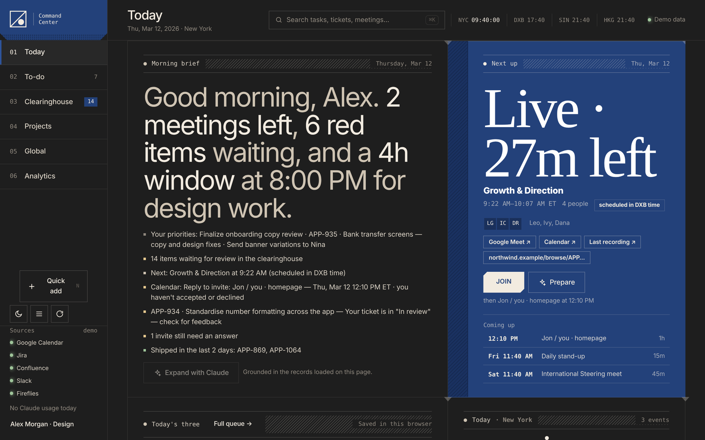
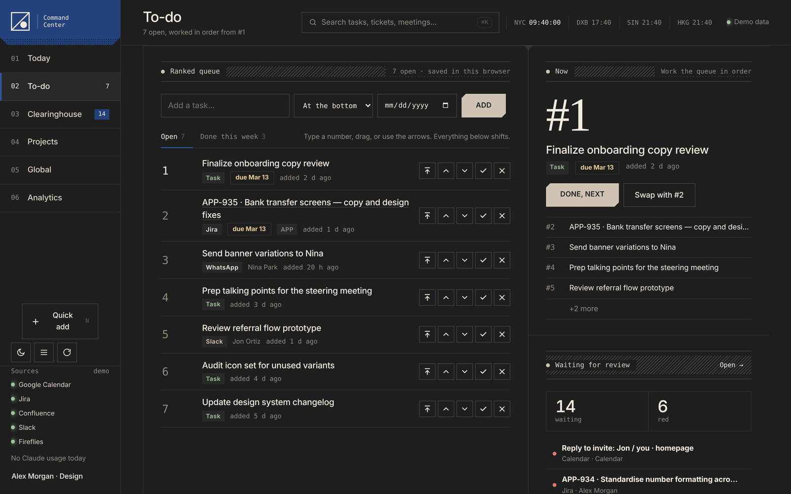
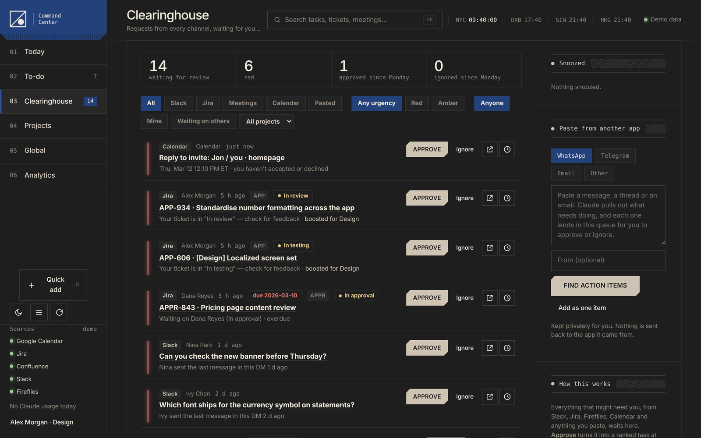
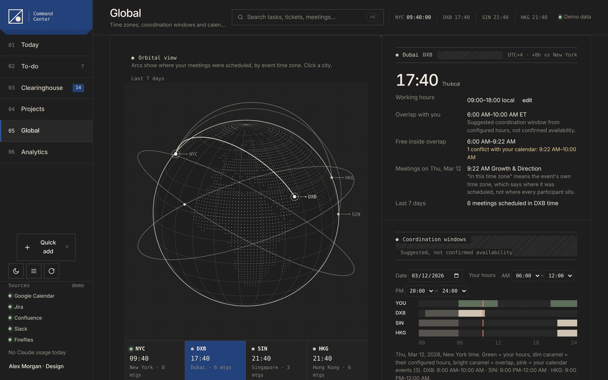
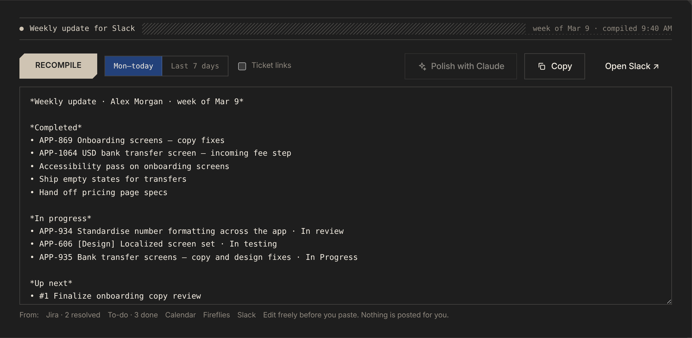

# Command Center

A personal dashboard for people who work across time zones. It reads your calendar, tickets, messages and meeting notes, and turns them into one page that tells you where to start.

It's a single HTML file. No build step, no server, no account. It runs as a [Claude](https://claude.ai) artifact and connects to your tools through Claude's connectors.

> All names, numbers and dates in these screenshots are demo data.

## Why I built it

I'm a product designer working up to 12 hours behind most of my team. By the time I logged on, everyone else's day was done, and what they needed from me was spread across a calendar, Jira, Slack threads, meeting recordings and the odd WhatsApp message. The first hour of every day went on working out where to start.

So I built the page I wanted to open every morning, used it every day, and kept changing it. Most of the features below came from colleagues telling me how they'd use it.

## What's inside

| View | What it does |
|---|---|
| **Today** | A morning brief, your next meeting with a live countdown, a timeline of your day, "Today's three" priorities and what needs you now. |
| **To-do** | One ranked list. Every task has a number from 1 up, with no high/medium/low tags. Type a new number, drag or use the arrows, and the rest of the list shifts. The "Now" panel keeps you on #1. |
| **Clearinghouse** | Requests from Slack, Jira, meeting notes and calendar invites land in one queue. **Approve** turns one into a ranked task; **Ignore** hides it here only. Paste a WhatsApp, Telegram or email message and Claude picks out the action items. |
| **Projects** | Workstream counts from your Jira filters, explicit blockers, key-date countdowns and pinned Figma files. |
| **Global** | Your cities on a globe, live clocks, overlap windows with each office and a flag when a meeting was set in someone else's time zone. |
| **Analytics** | A one-click weekly update ready to paste into Slack, plus meeting load, focus time, collaborators and ticket activity. |

| | |
|---|---|
|  |  |
|  |  |

## Try it

**Demo, no setup:** open `index.html?demo` in a browser (or the GitHub Pages link, if this repo has one). Everything runs on clearly labelled sample data.

**With your own data, in Claude:**

1. In Claude settings, connect the tools you use: Google Calendar, Atlassian (Jira and Confluence), Slack, Fireflies and Figma. You only need the ones you use.
2. Download `index.html` and `artifact.json` from this repo.
3. In a Claude conversation, attach both files and ask: *"Publish index.html as an artifact with the capabilities in artifact.json."*
4. Open the artifact, then pick your role, tools, hours and cities in the setup panel.

Artifact capabilities (connectors, storage, Claude drafting) depend on your Claude plan and your organization's settings.

## Setup

Everything lives in **Personalize** (bottom of the left menu):

- **You:** name, job title, work email and Slack member ID. The email and Slack ID tell the page which recordings and messages are yours.
- **Role:** changes what counts as urgent and how Claude drafts for you.
- **Tools you use:** unticked tools are never queried.
- **Hours and cities:** your working blocks plus up to six cities. These drive the clocks, globe and coordination windows.
- **Connections:** your Jira site and Slack workspace. The Atlassian cloud ID is found automatically the first time Jira loads. An optional JQL defines "waiting on others" (for example an approvals project); without one, it lists tickets you raised that someone else holds.

## How it works

- **One file.** HTML, CSS and plain JavaScript in `index.html`. Fork it and change anything.
- **Loading data costs no AI tokens.** Connectors are called directly. Claude only runs when you press a draft button (morning brief, stand-up, weekly polish, reply drafts, paste-in extraction), and every draft is grounded in the records the page loaded.
- **Nothing is sent anywhere without you.** The page never posts to Slack, comments on Jira or emails anyone. The one write is creating a focus block on your calendar, and only after you confirm it.
- **Your data stays yours.** Tasks, priorities and settings sit in your private artifact storage, or your browser when opened outside Claude. A compact copy of the last load is kept in your browser, so the page still shows something if a connector is down. The only outside request is for fonts from Google Fonts.
- **Accessible and responsive.** Keyboard shortcuts (`1`–`6` to switch views, `N` for a new task, `⌘K` to search), reduced-motion support, light and dark themes, and a phone layout.

## Customizing

Search `index.html` for these sections:

- `CFG`: defaults and connector names.
- `Fetch`: the queries sent to each tool.
- `buildInbox`: what counts as a request, and how urgent it is.
- `ROLES`: role presets.
- `BLUEPRINT SKIN`: the visual theme (colours, type, grid).

## Credits

Designed and built by Sam Mostafa, with Claude.

## License

MIT. See [LICENSE](LICENSE).
